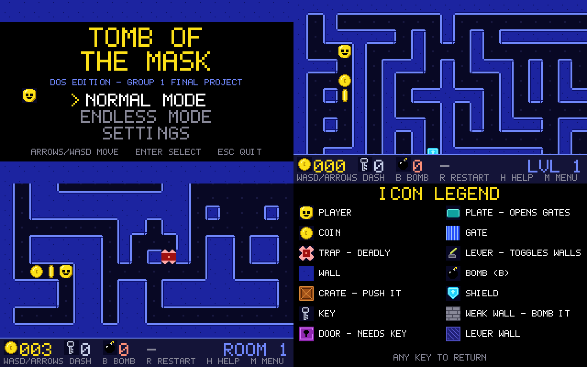

# Tomb of the Assembly - DOS edition (x86 assembly)

The whole game is written in **x86 assembly** (16-bit real mode, 80386 instructions, GNU `as` Intel syntax)
and builds a 24 KB DOS program, `TOMB.COM`, that runs in DOSBox.

* **How to run it, step by step: see [HOW_TO_RUN.md](HOW_TO_RUN.md)** (double-click `RUN.BAT` after installing DOSBox).
* Same core rules and controls as the ICMC version, but zoomed in (16x16 tiles, smooth scrolling camera),
  with a five-map authored campaign, a Tomb-of-the-Mask-style endless-mode generator, rising lava in endless mode,
  a stage-failed death overlay, and an instant room change.

## What changed compared to the ICMC version
| | |
|---|---|
| Platform | DOS / DOSBox, VGA 320x200, double-buffered, synced to the 70 Hz retrace |
| Zoom | about 20x10 tiles visible, camera follows the player; auto-tiled walls, sprites, spiked traps |
| Maps | five authored 40x28 ICMC maps live in `Simulador/tomb_of_mask.asm`; the campaign uses these maps, and the extractor copies them into the DOS assembly and C reference data. Endless mode uses generated rooms with chambers, obstacles, and solver-checked placements |
| Endless pressure | a red lava trail climbs from below, advances every second, and ends the run when it reaches the player |
| Trap feedback | hitting an unshielded trap displays **STAGE FAILED** before restarting a normal stage or ending an endless run |
| Slow room change | the ICMC version redrew all 1200 cells 30-40 times and waited ~2.7M simulated instructions after each step. Here the change is one memory blit per frame (~0.3 s) and only changed frames are drawn. A patched `Simulador/tomb_of_mask.asm/.mif` (4 words changed) makes the old version ~4x faster too |

## Is it really assembly?
Yes: every file in `src/` is assembly (`.s` / `.inc`). The only generated parts are data tables
(sprites, font, palette, and map copies from `Simulador/tomb_of_mask.asm`) written as assembly data by `tools/*.py`.
The folder `reference_c/` holds a C implementation of the same game. It is **not** part of the program:
it is only used by the tests as an oracle.

## How it was tested
`make test` runs the assembly build and the C reference side by side in a small 386 emulator (`tests/x86run.c`)
and compares them:
* generated rooms (60+ random seeds, depths 1-60): byte-identical, including the random generator state;
* frames: identical pixel for pixel through campaign stages and room-change scrolls, random key presses through menus/settings/help/bombs/restarts, and four solver-driven endless rooms.

**Not tested here:** real DOSBox and a real Windows machine were not available. The emulator is my own and covers
the instructions this program uses. Please smoke-test it in DOSBox (see HOW_TO_RUN.md) and tell me if anything
looks different.

## Layout
    dos/   TOMB.COM  RUN.BAT  tomb.conf  HOW_TO_RUN.md  Makefile  src/  tools/  tests/  reference_c/
    Simulador/   patched tomb_of_mask.asm / .mif for the original simulator (faster room change)

To regenerate both map copies after editing the five simulator maps, run from `dos/`:

    python3 tools/extract_levels_asm.py ../Simulador/tomb_of_mask.asm src/levels.inc reference_c/src/levels.h

On Windows, use `py -3` in place of `python3`.
